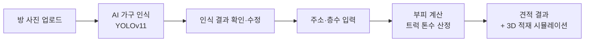

# 짐픽 (zimpic)

**방 사진만 찍으면 AI가 가전·가구를 인식해 이사 비용을 예측하는 서비스**

| 기간 | 인원 | 내 역할 |
| --- | --- | --- |
| 2026.01.12 ~ 2026.02.04 (24일) | 4명 (ML 1 · BE 2 · FE 1) | 백엔드 · 기획 |

## 왜 만들었나

기존 이사 견적 서비스에서는 사용자가 이삿짐을 하나하나 입력하고 트럭 톤수까지 직접 골라야 했습니다. 짐의 규모를 가늠하기 어려운 사용자에게는 부담이 큰 과정입니다.
짐픽은 **사진 한 장으로 짐을 파악하고, 필요한 차량과 비용까지 자동으로 계산**합니다.

## 서비스 흐름

## 기술 스택

| 분야 | 기술 |
| --- | --- |
| ML | Python, YOLOv11, OWLv2, Label Studio |
| Backend | Django, Django REST Framework, MySQL |
| Frontend | React, Vite, Zustand, Three.js |

## 담당 업무

- **견적 산출 정책 설계**: 요금을 기본요금, 접근비용(사다리차/계단), 거리, 특수가구로 나눴습니다. 기본요금은 한국소비자원 통계에 최저임금 상승률을 반영해 2026년 기준으로 정했습니다.
- **견적 산출 API**: 짐 부피(CBM) 계산, 트럭 구성 산정, 거리 조회, 항목별 요금 계산
- **DB 설계**: 정책 기준 데이터(가구·트럭·요금표)와 견적 결과 스냅샷 테이블
- **관리자 페이지**: 요금 정책을 코드 수정 없이 바꿀 수 있는 Django Admin

## 트러블슈팅

**국내 환경에 맞는 학습 데이터가 없음**
→ 국내 실내 사진을 크롤링하고, 제로샷 모델(OWLv2)로 자동 라벨링해 커스텀 데이터셋을 만들었습니다.

**클래스를 너무 넓게 잡아 초기 성능이 약 0.4에 그침**
→ 라벨링 신뢰도 임계값을 조정하고, 견적에 영향을 주는 핵심 클래스만 남겼습니다(53개 → 38개). 학습·검증 데이터는 클래스별로 고르게 8:2로 나눠 안정적으로 평가했습니다.

## 배운 점

- 실제 서비스용 ML에서 가장 많은 시간이 드는 일은 데이터 수집과 정제였습니다.
- 클래스 수보다 **서비스 목적에 맞는 클래스 선별**이 성능에 더 중요했습니다.
- 데이터를 나눌 때 클래스 분포를 고르게 맞춰야 모델이 특정 객체에 치우치지 않았습니다.

## 문서

기획·정책·모델·API 상세는 [docs/](docs/README.md)에 있습니다.

## 서비스별 로컬 실행

- [FastAPI YOLO 추론 서버](yolo/README.md)